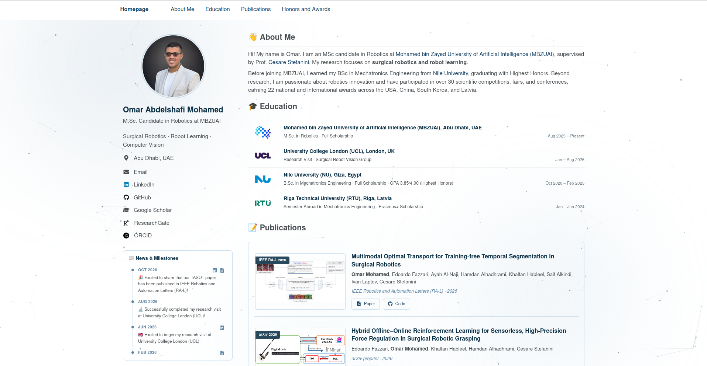

\<div align="center">

# Omar Abdelshafi Mohamed

### Personal Academic Website

**M.Sc. Candidate in Robotics | Mohamed bin Zayed University of Artificial Intelligence (MBZUAI)**

*Surgical Robotics · Robot Learning · Computer Vision*

[**🌐 Visit My Website**](https://omar8ahmed9.github.io)

\</div>

---

## Overview

This repository contains the source code for my personal academic website, showcasing my research, academic background, publications, and achievements.

The website is designed to provide a clean, responsive, and accessible overview of my academic journey.

## Website Preview

\<div align="center">

\<a href="[https://omar8ahmed9.github.io](https://omar8ahmed9.github.io)">   \ \</a>

*Click the image to visit the live website.*

\</div>

## Features

- **About Me:** Academic background and research interests.
- **Education:** Academic qualifications and international research experience.
- **Publications:** Published research papers and preprints.
- **Honors and Awards:** Scholarships and selected achievements.
- **News & Milestones:** Chronological updates on research activities and accomplishments.
- **Responsive Design:** Optimized for desktop and mobile devices.
- **Custom Visual Design:** Scientific Blue color palette with subtle animated particle and aurora backgrounds.

## Technologies

The website is built using:

- **Jekyll** — Static site generator.
- **AcadHomepage** — Academic website template.
- **Minimal Mistakes** — Theme architecture.
- **HTML, SCSS, and JavaScript** — Custom layouts, styling, and animations.
- **GitHub Pages** — Hosting and deployment.

## Local Development

Clone the repository:

```bash
git clone https://github.com/omar8ahmed9/omar8ahmed9.github.io.git
cd omar8ahmed9.github.io
```

Install dependencies:

```bash
bundle install
```

Start the development server:

```bash
bundle exec jekyll serve --livereload
```

Open `http://localhost:4000` in your browser.

## Deployment

The website is hosted on **GitHub Pages** and automatically deployed from the `main` branch.

**Live website:** [https://omar8ahmed9.github.io](https://omar8ahmed9.github.io)

## Acknowledgments

This website is based on [AcadHomepage](https://github.com/RayeRen/acad-homepage.github.io), developed by **Yi Ren (RayeRen)** and distributed under the MIT License.

The original template incorporates or draws upon several open-source projects, including:

- [Minimal Mistakes](https://github.com/mmistakes/minimal-mistakes)
- [Academic Pages](https://github.com/academicpages/academicpages.github.io)
- [Font Awesome](https://fontawesome.com/)

I gratefully acknowledge the original developers and contributors whose work provided the foundation for this website.

The design, content organization, styling, and interactive elements have been customized for my personal academic website.

## License

The original AcadHomepage source code is distributed under the **MIT License**, with copyright © 2022 Yi Ren.

The original copyright and license notices are preserved in the repository's [LICENSE](LICENSE) file.

Third-party components remain subject to their respective licenses.

---

\<div align="center">

**© 2026 Omar Abdelshafi Mohamed — Personal Website Content**

[Website](https://omar8ahmed9.github.io) · [GitHub](https://github.com/omar8ahmed9)

\</div>
